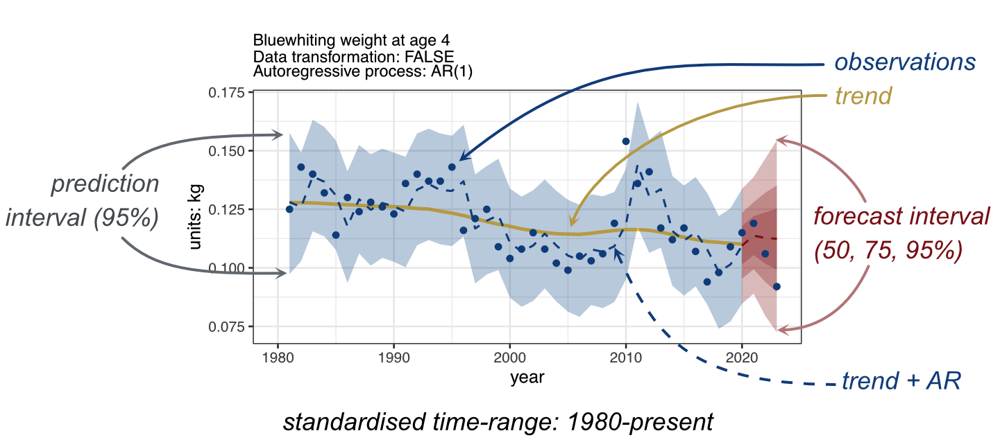

```{r, knitr, echo=FALSE, message=FALSE, warning=FALSE}
library(knitr)
#opts_chunk$set(echo=FALSE, message=FALSE, warning=FALSE,
#  fig.width=6, fig.height=5, out.width="90%", fig.pos='!hbt')
library(officedown)
library(officer)
library(flextable)
```

```{r outputs, echo=FALSE}
load("./output/tables.Rdata")
```

## Principles

The ATAC analysis aims to characterise the temporal dynamics of each individual time series by modelling its underlying trend and, where supported by the data, its autoregressive (AR) structure. Models are fitted over a standardised reference period ( here 1980–2023). 
The fitted models are used to estimate the underlying trend and the associated prediction uncertainty, expressed as 95% prediction intervals. The same models are subsequently used to generate forecasts for the years following the reference period, together with their associated forecast intervals. As observations become available for these years, they can be compared with the forecast estimates and intervals to assess whether recent developments are consistent with the temporal dynamics observed during the reference period.

The interpretation is based on two complementary aspects:

- **Long-term temporal dynamics:** The estimated trend and autoregressive structure are used to characterise the temporal behaviour of each time series. The trend component identifies long-term patterns, such as increasing or decreasing trajectories, as well as non-linear temporal variation. The autoregressive component characterises temporal dependence (or *memory*) in the series, indicating the extent to which observations in a given year are related to observations in preceding years.

- **Recent changes:** Recent observations are evaluated against the forecasts and their associated prediction intervals. Observations falling within the forecast intervals are considered consistent with the temporal patterns and variability estimated from the reference period. Observations falling outside these intervals indicate departures from the expected trajectory, suggesting changes in the dynamics of the time series relative to those characterised during the reference period.


The modelling is done with the [BRMS package](https://paul-buerkner.github.io/brms/). The plotting is done using the [ggplot2 package](https://ggplot2.tidyverse.org)

## Modelling of the trends, prediction and forecasting bands for the period 1980-present using the brms package

The modelling is performed in the following steps:

1. **Candidate model fitting:** Three models are fitted to each time series:
   - A generalised additive model (GAM) with a smooth trend component and no autoregressive process: `brm(y ~ s(x))`.
   - A GAM with a first-order autoregressive process (AR(1)): `brm(y ~ s(x), autocor = cor_ar(p = 1))`.
   - A GAM with a second-order autoregressive process (AR(2)): `brm(y ~ s(x), autocor = cor_ar(p = 2))`.

2. **Model selection:** The three candidate models are compared using leave-one-out cross-validation (LOO-CV). The model with the lowest LOO information criterion (LOOIC) is selected.

3. **Trend and prediction estimation:** The selected model is used to estimate the underlying trend and generate predictions over the full time series.

4. **Prediction intervals:** Prediction percentiles corresponding to 2.5%, 12.5%, 25%, 75%, 87.5% and 97.5% are calculated, allowing the uncertainty around the predictions to be represented by 50%, 75% and 95% prediction intervals.

5. **Truncated model fitting:** A second model is fitted using only observations up to and including 2021. This truncated model has the same structure as the best-fitting model selected in step 2, including the same autoregressive order (if applicable).

6. **Forecast generation:** The truncated model is used to generate forecasts for 2022, 2023 and 2024.

7. **Forecast intervals:** Forecast percentiles are calculated to quantify forecast uncertainty and derive 50%, 75% and 95% forecast intervals.

8. **Archiving:** The full-period model, truncated model, estimated trends, predictions and forecasts, together with their associated uncertainty intervals, are archived.

**Additional considerations and assumptions**

All models assume Gaussian-distributed errors. For time series that show substantial departures from normality, the original observations are pre-transformed using a double square-root (fourth-root) transformation. This transformation reduces skewness and provides a rescaling of the data that can improve compatibility with the Gaussian error assumption.

For time series shorter than 20 years, models including autoregressive processes are not fitted, as the estimation of AR coefficients is considered unreliable with shorter time series. In these cases, the trend-only model is selected by default.

## Standardised time-series graphs

The standardised representation is highlighted in Figure \@ref(fig:ATACprinciples). Each plot corresponds to one time-series for the WGINOR set, with the following:\
- observations shown as blue dots\
- the truncated trend (without AR) shown as a dark yellow plain line.\
- the truncated model (= trend+AR) shown as a blue dashed line. If there is no AR process the trend and the model sit on top of each other.\
- the 95% prediction band for the period 1980 to 2020 indicated as a grey ribbon.\
- the forecasts values for the period 2021 to 2023 indicated as a dark red line.\
- the forecast bands for 50%, 75% and 95% indicated as dark/medium/light red ribbons.\
When the observations in the last three years are on the edge or outside the forecast bands, this can be interpreted as a departure (a stall) for the trend in recent years.

```{r ATACprinciples, echo=FALSE, fig.cap="An example of ATAC results highlighting the different graphical elements used for the interpretation of temporal changes.", fig.height=3, fig.width=6}

```

## Results

```{r ATACfigures, echo=FALSE, fig.height=8.49, fig.width=6}
fig2plot <- file.path(".","report",list.files("report")) # list of figure files in the report directory
include_graphics(fig2plot)
```
